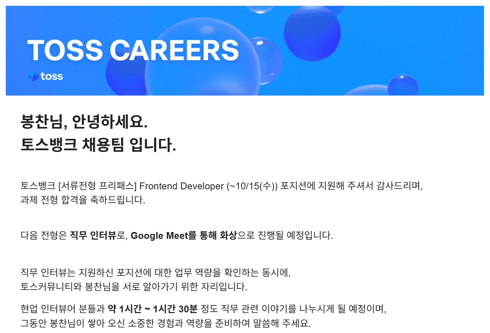
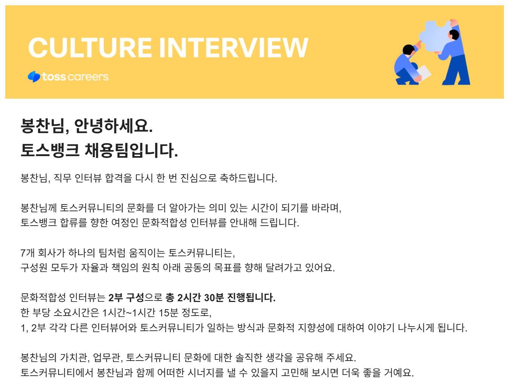
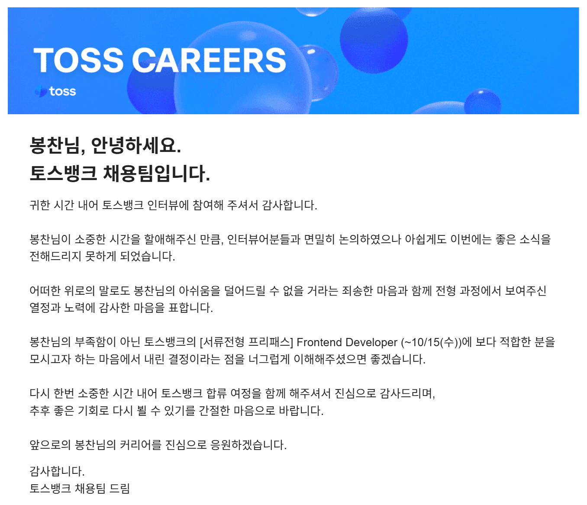

## 토스뱅크 Frontend Developer 지원

토스는 평소에 동경하는 회사로 언젠가 꼭 가보고 싶다는 생각이 있었다.

이번에 토스뱅크에서 [서류전형 프리패스] 채용 공고로 모든 지원자에게 과제를 볼 수 있는 기회를 줘서 토스는 어떤 과제를 볼지 궁금하기도 했고 현재 나는 삐뚤빼뚤 가더라도 바른길을 가고 있는지 알아보고 싶었다.

이렇게 가벼운 마음으로 지원하게 되었지만 모든 전형에서 내가 할 수 있는 최선을 다했다.

합류 여정은 다음과 같다.

과제 전형 -> 직무 인터뷰 -> 문화적합성 인터뷰 -> 레퍼런스 체크 -> 처우 협의 -> 최종 합격 및 입사

## 과제 전형

토요일 14시에서 일요일 14시까지 24시간 동안 요구 사항을 구현하는 과제였다.

처음 요구 사항을 확인하고 분석 후에 진지하게 개발을 진행했다.

주어진 요구 사항은 모두 구현했지만 일요일에 중요한 일정이 있어서 리팩토링은 진행하지 못하고 제출 시간보다 빠르게 제출하게 되었다.

그래도 정말 최선을 다했고 과제를 하는 동안 정말 즐겁다고 생각했다.

큰 기대는 안 했는데 결과는 놀랍게도 **합격**했다.

## 직무 인터뷰

과제 합격 소식을 듣고 다시 한번 셀프 리뷰 및 어떻게 개선하면 좋을지 고민도 많이 했고 그 과정에서 React, TypeScript에서 중요한 개념들을 다시 정리했다.

면접에는 합류했을 때 가장 가깝게 일하게 되는 프론트엔드 개발자 두 분이 들어오셨다.

나름 많이 고민했다고 생각했는데 내가 생각하지 못한 관점에서 질문들이 많이 들어와서 배울 점이 많은 면접이었다.

면접이 종료되고 이제 내가 질문하는 시간이 찾아왔다. 나는 나에게 어떤 가치를 보고 이런 기회를 주셨는지 여쭤봤다.

지원자에 대한 평가는 공개하면 안 되도록 철저하게 훈련받아서 알려줄 수 없다고 하셨다. 하지만 **봉찬님이 잘하셔서 합격하신 거예요.** 라는 말을 들었을 때 뭔가 미묘한 감정이 들었다.

끝으로 사실 나는 합격하지 못하겠다는 느낌을 받았고 가족한테 전화해서 긴장도 너무 많이 하고 너무 어려워서 아마 좋은 결과는 받기 어려울 거 같다는 소식을 전했다.

바로 다음 날 결과가 나왔다.

**합격**

## 문화적합성 인터뷰

최종 면접까지 와서 솔직히 **이러다 진짜 토스 가는 거 아니야?** 하는 기대도 했다.

문화 적합성 인터뷰 메일에 토스 커뮤니티에 대한 안내 링크가 있었고 해당 링크에서 토스의 문화를 접했다. 그리고 유튜브, 토스 피드 등 토스가 원하는 인재상을 찾아봤다.

또한 나의 가치관을 정리하기도 했고 좋아하는 책, 애니를 보면서 힐링하는 시간도 가졌다.

1부, 2부 다른 면접관님이 들어오셨고 1부에서 진행되는 인터뷰는 2부 면접관님과 공유되지 않아서 중복되는 질문을 받을 수 있다고 안내받았다. 그리고 답이 있는 면접이 아니기 때문에 나의 솔직한 생각을 말해주면 된다고 하셨다.

토스가 좋아하는 인재상을 알기에 거짓말을 해서 면접을 봤을 수 있지만 나는 정말 내가 가진 가치관, 업무관을 있는 그대로 말씀드렸다.

과제 전형, 직무 인터뷰 전형과 다르게 이번에는 합격에 더 가능성을 두고 있었다.

이번에도 다음 날 결과가 나왔다.

**불합격**

## 마무리

최종 면접까지 도달했기에 아쉬움도 많이 남았지만 많은 배움이 있었고 이번 합류 여정을 통해서 자신감도 많이 얻게 되었다.

내가 조금은 느리고 삐뚤빼뚤 가더라도 잘 가고 있었구나 생각도 들고 더 열심히 해야겠다는 생각도 들었다.

사실 최종 불합격 메일을 받았을 때 눈물이 날 정도로 아쉽진 않았는데 가족에게 전화로 소식을 전했을 때 **만족했으면 됐지 고생했다.** 는 말을 들으니까 눈물이 났다.
